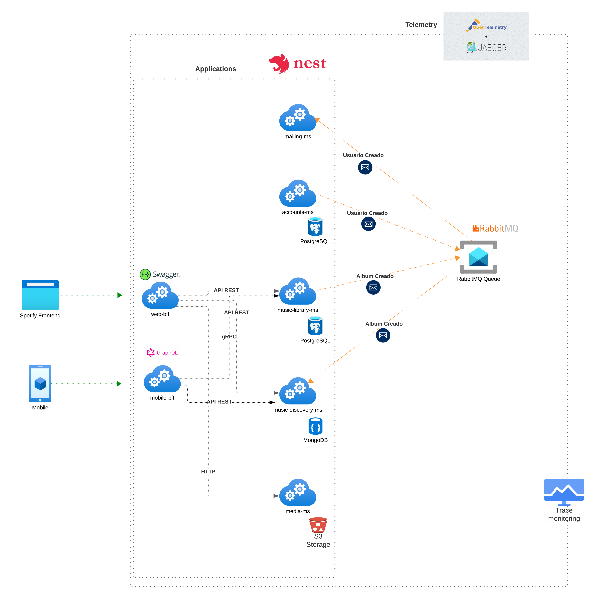
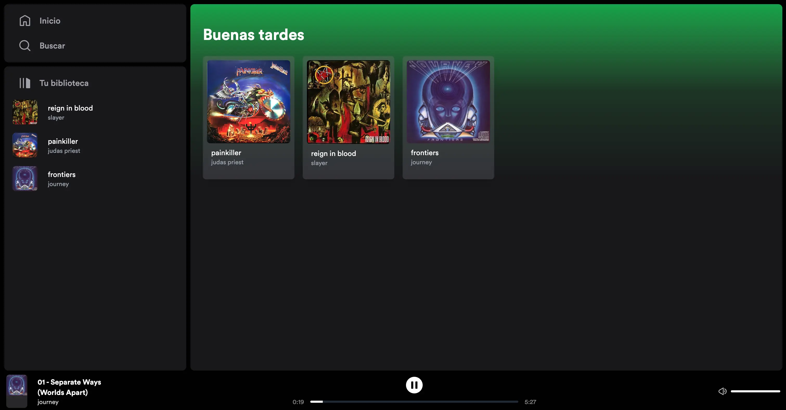

# 🚀 Microservices Architecture with NestJS

This repository provides examples and guides on how to implement microservices architecture patterns using NestJS. It is inspired by the complexity and challenges of a platform like Spotify. We will build a clone that emulates the most common features of the famous music platform. Through this project, you will explore best practices, structures, and key concepts for developing scalable and maintainable microservices-based applications.

## 🎯 Objective

The main purpose of this project is:

* Provide clear and detailed examples of how to implement microservices architecture patterns using NestJS.
* Present practical examples representing key features of a music platform, such as user management, authentication, music library, and playlists.
* Facilitate a learning environment where you can understand not only the fundamentals of NestJS but also its practical application in a microservices environment.

## 📚 Learning Modules

* 1 - Application Design
    * [Building Scalable and Maintainable Applications](docs/how-to-build-scalable-and-maintainable-apps.md)
    * [Simplifying Unit Testing with Hexagonal Architecture](docs/easy-unit-testing-with-hexagonal.md)
    * [Simplifying E2E Testing](docs/e2e-testing.md)
* 2 - Observability
    * [Distributed Traces](docs/distributed-traces.md)
* 3 - Inter-Microservice Communication
    * [Microservices Communication](docs/microservices-communication.md)
    * [Advanced Synchronous Communication](docs/advanced-sync-communication.md)
    * Advanced Asynchronous Communication
        * [Domain Events vs Integration Events](docs/domain-events-vs-integration-events.md)
        * [Distributed Transactions with Saga Patterns](docs/distributed-transaction-with-saga-patterns.md)
* 4 - Exposing Microservices to Clients
    * [BFF Pattern (Backend For Frontend)](docs/bff-pattern.md)

## 🏗️ Microservices Architecture

The following architecture diagram shows the available microservices and the technologies used.



## 📦 Available Applications

All microservices and components are described here:

* `spotify-monolith`: Monolithic Spotify clone application that manages users, the song library, and playlists.
* `music-library-ms`: Microservice that manages the music library of artists, albums, songs, and genres for our Spotify clone.
* `music-discovery-ms`: Microservice that manages radios and playlists aimed at helping users discover new music.
* `accounts-ms`: Microservice that manages user accounts.
* `mobile-bff`: Backend For Frontend for the mobile application, responsible for fetching the music library, playlists, and radios, and exposing the data as a GraphQL API.
* `web-bff`: Backend For Frontend for the web application integrated with an [AstroJs-based app](https://github.com/nullpointer-excelsior/spotify-clone-frontend). This BFF fetches the music library, playlists, and radios, and exposes the data as a REST API.
* `mailing-ms`: Microservice responsible for sending emails.
* `media-ms`: Microservice responsible for delivering audio and image resources related to the music catalog.

## 🛠️ Technologies Used

* `NestJS`: Node.js framework with TypeScript.
* `Docker`: Platform for creating and running containerized applications.
* `Postgres`: Relational database management system.
* `MongoDB`: Document-oriented NoSQL database.
* `RabbitMQ`: Message broker for inter-microservice communication.
* `Redis`: In-memory message broker for integration events based on a pub/sub model.
* `Minio Storage`: S3-compatible object storage management service.
* `OpenTelemetry`: Library designed to collect telemetry data and send it to the configured OTLP server.
* `Jaeger UI`: OTLP service designed to collect telemetry data from microservices and provide trace information.

## 📁 Monorepo with NestJS

NestJS provides a straightforward way to create monorepos where you can create shared libraries or applications with simple commands. We leverage this to organize our microservices. For more information, see the [NestJS workspaces documentation](https://docs.nestjs.com/cli/monorepo).

## 📂 Directory Structure

The folder structure is as follows:

* `apps`: NestJS applications — in our case, these are our microservices.
* `libs`: Shared libraries used by microservices to reuse components.
* `infrastructure`: Everything related to the infrastructure needed to run our microservices.
* `docs`: Documentation of patterns and techniques used in microservices.
* `jobs`: Jobs responsible for configuration or initial data loading.
* `scripts`: Definition of complex bash scripts that cannot be handled from package.json.

## ▶️ Running the Applications

You can run a minimal stack to view a frontend application adapted from a [midudev tutorial](https://www.youtube.com/watch?v=WRc8lz-bp78) and adapted to connect with the Spotify-clone microservices stack. You can also start other services to see the examples from each article in this repository working.

> Spotify clone frontend with AstroJs is [here](https://github.com/nullpointer-excelsior/spotify-clone-frontend)

## ⚙️ Installation

Make sure you have:

* Node version 20 or higher (see `.nvmrc`)
* Docker
* python3

Install dependencies using npm install.

```bash
#!/bin/bash
npm install
```

> **Migration note:** This repository has been migrated to NestJS `^11.1.x`.
> If you are coming from the previous version, check
> [`artifacts/workspace/notes.md`](artifacts/workspace/notes.md) for
> phase-by-phase details.

## Migration Notes (Nest 11)

The migration to NestJS 11.1.x was executed in 8 phases, each with its
own commit and local tag (`nest11-phase-0` ... `nest11-phase-7`,
`nest11-final`). The per-phase log is at
[`artifacts/workspace/notes.md`](artifacts/workspace/notes.md). Highlights:

- **Express 5** + `path-to-regexp` 8 (named wildcards, e.g., `audio/{*path}`).
- **Apollo Server 5** + **GraphQL 17** + `@nestjs/graphql` 13.
- **TypeORM 11**, **Mongoose 8** (with `@nestjs/mongoose` 11).
- **OpenTelemetry 0.221** + `nestjs-otel` 8 (API 1.9).
- Real e2e tests for all 12 microservices and 2 BFFs (the
  original `Hello World!` tests were replaced).
- `engines.node: ">=20"` and `.nvmrc` with `20`.

### 🔐 Environment Variables

All applications, jobs, and infrastructure are configured through environment variables defined in the `.env` file.

### 🏗️ Starting Infrastructure

To start the database, S3, telemetry, and message broker infrastructure, run the following command:

```bash
#!/bin/bash
npm run start:infra
```

### 🎵 Starting the Example Stack

Depending on the case or example you are viewing, you can run one or more applications. To start a basic stack with a frontend client application, you can start the following services:

```bash
#!/bin/bash

# music catalog API
npm run start:music-library
# media server for audio and images
npm run start:media-ms
# backend for frontend responsible for consolidating all microservice endpoints into a single entry point for client applications
npm run start:web-bff
# example spotify frontend
npm run start:frontend
```

### 💿 Loading the Music Catalog

To load the sample music catalog, run the `jobs/create_music_library.py` script.

```bash
#!/bin/bash

pip install -r jobs/requirements.txt

python jobs/create_music_library.py
```

You should now have the Spotify Clone frontend running at http://localhost:4321/ with a sample music catalog.



## 🧪 Unit and E2E Testing

You can run unit tests with:

```bash
#!/bin/bash
npm run test
```

And run e2e tests as follows:

```bash
#!/bin/bash

# start infrastructure for e2e testing
npm run start:e2e-infra

# run all e2e tests for the microservices architecture
npm run e2e:all
```

You can also run e2e tests separately for each microservice:

```bash
#!/bin/bash

npm run e2e:music-library

npm run e2e:music-discovery

npm run e2e:mobile-bff
```

### 🛑 Stopping Infrastructure

If you want to stop the infrastructure, the following commands are available:

```bash
#!/bin/bash

# stop the main microservices infrastructure
npm run stop:infra
# stop the e2e testing infrastructure
npm run stop:e2e-infra
```

To run project components individually, the following scripts are available:

```bash
# Install dependencies using npm install
npm install

# Format Code
npm run format

# Start Infrastructure (Docker Compose)
npm run start:infra

# Stop Infrastructure (Docker Compose)
npm run stop:infra

# Start End-to-End Test Infrastructure
npm run start:e2e-infra

# Stop End-to-End Test Infrastructure
npm run stop:e2e-infra

# Start Individual Components:

## Spotify Monolith
npm run start:spotify-monolith

## Music Library
npm run start:music-library

## Music Discovery
npm run start:discovery

## Accounts
npm run start:accounts

## Mobile BFF
npm run start:mobile-bff

## Web BFF
npm run start:web-bff

## Mailing Service
npm run start:mailing

## Media Server
npm run start:media

# Run Unit Tests for all applications

npm test

# Run End-to-End Tests

## Spotify Monolith
npm run e2e:monolith

## Music Library
npm run e2e:music-library

## Mobile BFF
npm run e2e:mobile-bff

## Music Discovery
npm run e2e:music-discovery

## All e2e tests
npm run e2e:all

# Linting
npm run lint
```

## 📖 Additional Resources

* [Official NestJS Documentation](https://docs.nestjs.com/)
* [Microservices Patterns Documentation](https://microservices.io/patterns/index.html)

## 👨‍💻 Credits

Developed by **Benjamín**
