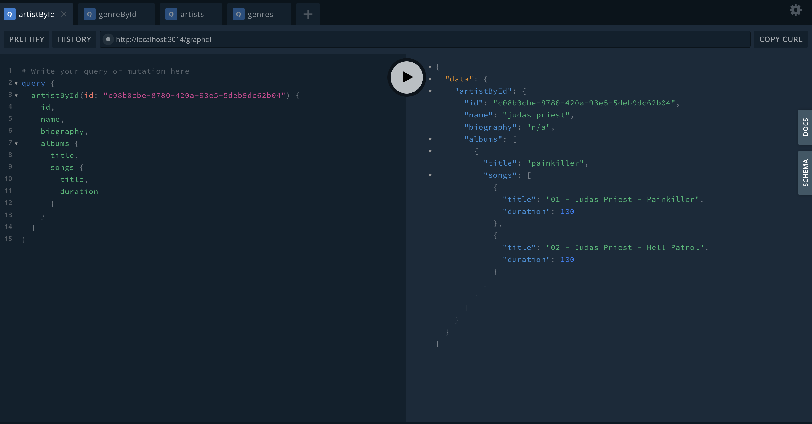

# 🔄 Advanced Synchronous Communication in Microservices

In a microservices architecture, we can communicate our applications synchronously and asynchronously. In this article, we will explore advanced synchronous communications. While RESTful is the simplest way to communicate with a microservice, efficiency and flexibility in inter-service communications are fundamental. Two technologies that have revolutionized this area are gRPC and GraphQL. These tools offer distinct but powerful approaches for handling communications between microservices, each with its own advantages and use cases.


## 🔌 gRPC for Efficient Communications

### ❓ What is gRPC?

gRPC is an open-source communication framework developed by Google. It uses the HTTP/2 protocol for efficient data communication, allowing developers to define their services using the Protocol Buffers Interface Definition Language (IDL). This technology is designed to be fast, efficient, and scalable, ideal for distributed environments.

### ⚡ Advantages of gRPC:

- **Performance**: Uses HTTP/2, which allows request multiplexing, minimizing latency and improving performance.
- **Strong typing**: Thanks to Protocol Buffers, it offers a strongly typed system that facilitates data definition and validation.
- **Bidirectional and streaming**: Supports bidirectional communication and real-time data streaming, making it suitable for applications with constant data update needs, such as chats or real-time tracking systems.

### ⚠️ Disadvantages of gRPC:

- **Implementation complexity**: The initial learning curve can be steep, especially for teams unfamiliar with Protocol Buffers or the RPC (Remote Procedure Call) communication paradigm.

- **Visibility and debugging issues**: Since it uses a binary format for data transfer, it can be harder to debug and visualize the transmitted data compared to text formats used in other protocols like REST.

- **Interoperability restrictions**: Although gRPC is highly efficient within its ecosystem, there may be limitations when interacting with systems that do not support or have difficulty integrating with HTTP/2 or Protocol Buffers.

## 📡 Implementing gRPC with NestJS

NestJS provides a straightforward way to implement a service with gRPC. While we will need to know how to implement the `.proto` file, the rest will be simple. In the following example, based on the Spotify-clone microservices stack, we will analyze the communication of a backend-for-frontend application called `mobile-bff`, which will communicate with the `music-library-ms` microservice, which provides the music catalog.

This example is quite close to reality, as a mobile application needs greater efficiency in connections. When mobile applications connect to a backend server where their internal services use gRPC, it will help reduce latency and network traffic between services, resulting in better response on the client side.

### 📜 Defining the Contract with a .proto File

This will be our contract. This file must be the same for all services that use gRPC.

```proto
// libs/music-library-grpc/src/music-catalog.proto
syntax = "proto3";

package catalog;

// Import necessary packages
import "google/protobuf/empty.proto";
import "google/protobuf/wrappers.proto";

message ID {
    string id = 1;
}

message Album {
    string id = 1;
    string title = 2;
    string photo = 3;
    int32 year = 4;
}

message Artist {
    string id = 1;
    string name = 2;
    string photo = 3;
    string biography = 4;
}

message Genre {
    string id = 1;
    string name = 2;
}

message Song {
    string id = 1;
    string title = 2;
    string video = 3;
    int32 plays = 4;
    int32 duration = 5;
    string artist_id = 6;
    string album_id = 7;
    string genre_id = 8;
}

service ArtistService {
    rpc GetAllArtists(google.protobuf.Empty) returns (stream Artist);
    rpc GetArtistById(ID) returns (Artist);
}

service AlbumService {
    rpc GetAllAlbums(google.protobuf.Empty) returns (stream Album);
    rpc GetAlbumById(ID) returns (Album);
    rpc GetAlbumsByArtistId(ID) returns (stream Album);
}

service SongService {
    rpc GetAllSongs(google.protobuf.Empty) returns (stream Song);
    rpc GetSongById(ID) returns (Song);
    rpc GetSongsByIds(stream ID) returns (stream Song);
    rpc GetSongsByArtistId(ID) returns (stream Song);
    rpc GetSongsByAlbumId(ID) returns (stream Song);
    rpc GetSongsByGenreId(ID) returns (stream Song);
}

service GenreService {
    rpc GetAllGenres(google.protobuf.Empty) returns (stream Genre);
    rpc GetGenreById(ID) returns (Genre);
}
```

Basically, here we will have:

- `messages`: the data structure we will exchange between services
- `services`: the available operations


The `music-library-ms` service will expose the services through the `@Controller` annotation. NestJS will know that this controller corresponds to a gRPC endpoint since we will configure our application as a microservice.

```typescript
//apps/music-library-ms/src/main.ts
app.connectMicroservice({
  transport: Transport.GRPC,
  options: {
    package: 'catalog',
    protoPath: join(__dirname, 'music-catalog.proto'),
  },
})
await app.startAllMicroservices()
```

Our controller will expose the services.

```typescript
// apps/music-library-ms/src/music-catalog/infrastructure/grpc/catalog.controller.ts
@Controller()
export class CatalogController {

  constructor(private catalog: CatalogUseCases) { }

  @GrpcMethod('ArtistService', 'GetAllArtists')
  getAllArtists(data: any, metadata: Metadata, call: ServerUnaryCall<any, any>): Observable<Artist> {
      return this.catalog.findAllArtists()
  }

  @GrpcMethod('ArtistService', 'GetArtistById')
  getArtistById(data: ID, metadata: Metadata, call: ServerUnaryCall<any, any>): Observable<Artist> {
      return this.catalog.findArtistById(data.id)
  }
    // other implementations of CatalogUseCases

}
```
> The `CatalogUseCases` class will have logic to obtain the music catalog.

Basically, we will have our gRPC server ready. Now we will define the client in the `mobile-bff` application:

```typescript
// apps/mobile-bff/src/mobile-bff.module.ts
@Module({
  imports: [
    ClientsModule.register([
      {
        name: 'MUSIC_CATALOG_PACKAGE',
        transport: Transport.GRPC,
        options: {
          package: 'catalog',
          protoPath: join(__dirname, 'music-catalog.proto'),
        },
      },
    ]),
  ],
  providers: [
    MusicCatalogClient
  ],
  exports: [
    MusicCatalogClient
  ]
  
})
export class MusicLibraryGrpcModule {}
```

We define our gRPC client with the `ClientModule` module. Now, based on the `.proto` file we defined earlier, we create the model in code with TypeScript.

```typescript
// libs/music-library-grpc/messages.ts

export interface ID {
  id: string;
}

export interface Album {
  id: string;
    title: string;
    photo: string;
    year: number;
}

export interface Artist {
  id: string;
    name: string;
    photo: string;
    biography: string;
}

export interface Genre {
  id: string;
    name: string;
}

export interface Song {
  id: string;
    title: string;
    video: string;
    plays: number;
    duration: number;
    artist_id: string;
    album_id: string;
    genre_id: string;
}

// libs/music-library-grpc/services.ts
export interface ArtistService {
    GetAllArtists({}): Observable<Artist>;
    GetArtistById(request: ID): Observable<Artist>;
}

export interface AlbumService {
    GetAllAlbums({}): Observable<Album>;
    GetAlbumById(request: ID): Observable<Album>;
    GetAlbumsByArtistId(request: ID): Observable<Album>;
}

export interface SongService { 
    GetAllSongs({}): Observable<Song[]>;
    GetSongById(request: ID): Observable<Song>;
    GetSongsByIds(request: ID[]): Observable<Song>;
    GetSongsByArtistId(request: ID): Observable<Song>;
    GetSongsByAlbumId(request: ID): Observable<Song>;
    GetSongsByGenreId(request: ID): Observable<Song>;
 }

export interface GenreService {
    GetAllGenres({}): Observable<Genre>;
    GetGenreById(request: ID): Observable<Genre>;
}
```

To instantiate the gRPC services, we need to create these components as follows:

```typescript
// libs/music-library-grpc/music-catalog.client.ts
@Injectable()
export class MusicCatalogClient implements OnModuleInit {

    private artistService: ArtistService;
    private albumService: AlbumService;
    private songService: SongService;
    private genreService: GenreService;
    
    constructor(@Inject('MUSIC_CATALOG_PACKAGE') private client: ClientGrpc) { }

    onModuleInit() {
        this.artistService = this.client.getService<ArtistService>('ArtistService');
        this.albumService = this.client.getService<AlbumService>('AlbumService');
        this.songService = this.client.getService<SongService>('SongService');
        this.genreService = this.client.getService<GenreService>('GenreService');
    }

    findAllArtists() {
        return this.artistService.GetAllArtists({});
    }
    // ... other methods
}
```

This way, the `MusicCatalogClient` class will implement a `Facade` to expose the services. Finally, we can import our module into the `mobile-bff` application.

```typescript
// apps/mobile-bff/src/mobile-bff.module.ts
@Module({
  imports: [
    MusicLibraryGrpcModule,
    // other modules
  ],
})
export class MobileBffModule { }
```

Now we can use our gRPC client.

```typescript
@Injectable()
export class SomeService {
    constructor(private grpc: MusicCatalogClient) {}
}
```

## 📊 GraphQL: Powerful Query Language

### ❓ What is GraphQL?

GraphQL is a data query and manipulation language developed by Facebook. Unlike traditional REST APIs, where clients receive predefined data, GraphQL allows clients to request only the data they need, making it highly flexible and efficient in terms of resource consumption.

### 📝 GraphQL and Its Query Language

GraphQL itself is a data query and manipulation language that allows clients to define the structure of the data they want to receive. This is done by constructing GraphQL queries, which specify the exact fields the client needs from services or APIs.

The GraphQL query language has a specific syntax for building these queries. Here is a basic example of what a GraphQL query would look like:

```gql
query {
  user(id: 123) {
    name
    email
    posts {
      title
      content
    }
  }
}
```
In this query, we are asking for information about a specific user by their ID, requesting the name, email, and the titles and content of their posts.

GraphQL queries are flexible and allow nesting fields and specifying relationships between them in a very structured way. In addition to queries, GraphQL also supports other operations, such as mutations for data modification and subscriptions for establishing real-time communication channels.


### 🎮 The Query Playground

Also, GraphQL, when starting a service, allows us to access a playground where we can perform queries and mutations. We will also have auto-generated documentation based on our code showing what queries, mutations, and subscriptions we can perform.

### ⚡ Advantages of GraphQL:

- **Precise data requests**: Allows clients to request only the necessary information through specific queries.

- **Query flexibility**: Clients can define the exact structure of the data they want to receive, allowing field nesting and relationship specification in a more flexible and structured way.

- **Reduced number of requests**: By being able to request multiple resources through a single query, the need for multiple server requests is reduced.

- **Robust development tools**: It has solid development tools like GraphiQL, which facilitate schema exploration and query building.

### ⚠️ Disadvantages of GraphQL:
- **Initial learning curve**: For those new to GraphQL, it may take time to understand its syntax and best practices for schema design.

- **Caching complexity**: The complexity of custom queries can make effective query caching difficult, although tools like Apollo Client offer solutions to mitigate this problem.

- **Possible inefficiency in nested queries**: Deeply nested or complex queries can lead to excessively heavy queries that require careful management to ensure server performance.

- **Server workload**: Poor management of complex or malicious queries could increase the load on the server, especially if adequate security and query control measures are not implemented.

## 🛠️ Implementing a GraphQL Server

Now we will implement a GraphQL example following the same previous example. We will configure our `mobile-bff` application as a GraphQL server that consumes the `music-library-ms` microservice with gRPC.

To create a GraphQL server, we need to create the following components:

- `Types and fields`: data model where we define our models and their properties
- `Queries`: structure of read operations on GraphQL
- `Resolvers`: services that will return or perform the operations defined in the GraphQL model.

NestJS allows us to use decorators to create the model. However, it is also possible to create a `.gql` file, which will represent the GraphQL model, but in that case we must implement the mapping of operations and objects.

In our example, there will only be read operations, i.e., queries, and we will use decorators.

We define our `mobile-bff` module.

```typescript
// apps/mobile-bff/src/mobile-bff.module.ts
@Module({
  imports: [
    ConfigModule.forRoot(),
    GraphQLModule.forRoot<ApolloDriverConfig>({
      driver: ApolloDriver,
      autoSchemaFile: join(process.cwd(), 'apps/mobile-bff/schema.gql'),
    }),
    MusicLibraryGrpcModule,
  ],
  providers: [
    ArtistResolver,
    AlbumResolver,
    GenreResolver,
    SongResolver,
    RadioResolver,
  ],
})
export class MobileBffModule { }
```
Now we define our data model.

```typescript
// apps/mobile-bff/src/music-catalog/graphql/models/artist.model.ts
@ObjectType()
export class Artist {

    @Field({ nullable: true })
    id: string;

    @Field()
    name: string;
    
    @Field({ nullable: true })
    photo?: string;

    @Field({ nullable: true })
    biography?: string;

    @Field(type =>[Album], { nullable: 'itemsAndList' })
    albums?: Album[]
  
}
```

We will define our resolver class.

```typescript
// apps/mobile-bff/src/music-catalog/graphql/resolvers/artist.resolver.ts
@Resolver(of => Artist)
export class ArtistResolver {

    constructor(private grpc: MusicCatalogClient) {}

    @Query(returns => Artist)
    artistById(@Args('id') id: string) {
        return this.grpc.findArtistById(id)
    }

    @Query(returns => [Artist])
    artists() {
        return this.grpc.findAllArtists().pipe(toArray())
    }

    @ResolveField()
    async albums(@Parent() artist: Artist) {
        return this.grpc.findAlbumsByArtistId(artist.id).pipe(toArray())
    }
    
}
```
Finally, we can test our example from our repository as follows:

```bash
#!/bin/bash

# start infrastructure
npm run start:infra
# start our music catalog with the gRPC server active
npm run start:music-library
# start the backend for frontend which acts as gRPC client and GraphQL server
npm run start:mobile-bff

```
Now you can perform queries in the playground at the URL: http://localhost:3014/graphql.




## 🏁 Conclusion

Establishing communication between microservices is not only based on the popular REST API approach. In this instance, we highlight gRPC and GraphQL, with their corresponding use cases. Defining the right strategy will help us create systems that better meet advanced requirements in microservices-based projects.
