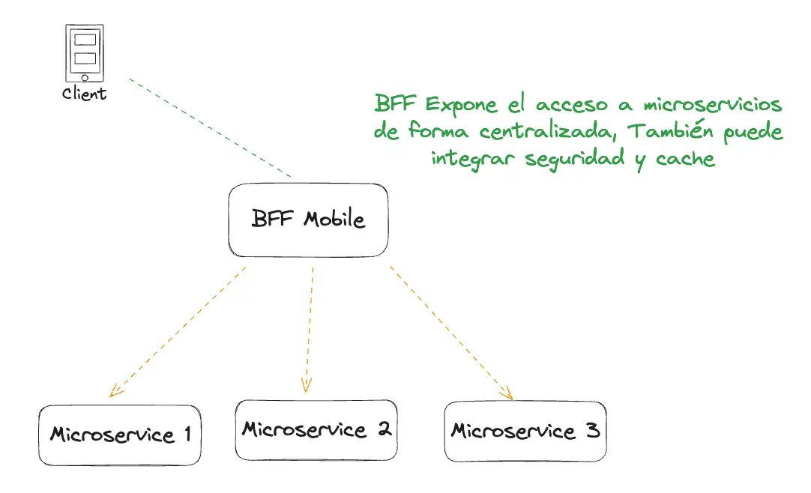
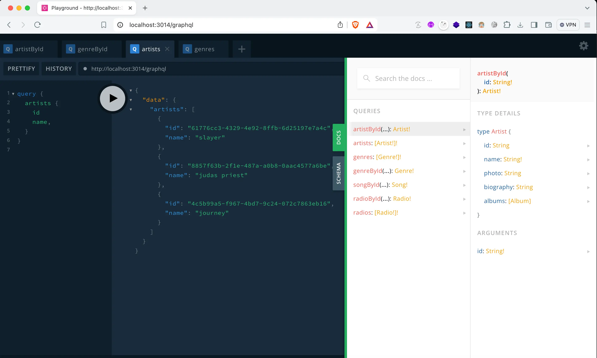

# 🎯 Backend for Frontend Pattern

When we opt for a microservices-based architecture, we have divided a complex system into small independent parts with defined responsibilities. In turn, the need arises to manage access and consumption of the microservices we have developed. To achieve this, we can use the BFF (Backend for Frontend) pattern. The idea is similar to that of an API gateway, a central component responsible for managing client requests and redirecting the request to the appropriate service. The big difference is that BFF is a specific application for a client application, such as a frontend, mobile application, or other type of client.

## 📋 Types of BFF

There are 2 main types of BFF:

- `Device-specific BFF`: a BFF application is built per device type, generally one for a web version and another for a mobile version.
- `Domain BFF`: focuses on building a BFF per functionality. For example, a BFF for sales, another for users, another for customers, etc.

## 📱 Example and Technological Implementation of Device-Specific BFF

We will take an implementation example of BFF based on our beloved Spotify clone architecture.

### 🌐 In Context

Our spotify-clone has 2 available clients: web and mobile. Both applications are defined for a specific client, as each client type has different requirements. For example, a mobile application will have to deal with latency issues and will also have many more features than a web version application. Therefore, the API design of the mobile BFF should be able to offer a high level of flexibility. On the other hand, our web BFF version will not have to deal with latency issues as frequently as the mobile version, and the number of features may differ compared to the mobile version. To build our BFFs, we will opt for 2 different technologies:

- `web-bff`: Backend application based on RESTful.
- `mobile-bff`: Backend application based on GraphQL.

## ⚖️ GraphQL vs RESTful

GraphQL is a technology that allows clients to specify exactly what data they need in a single request and returns structured responses as requested, typically using a single endpoint. On the other hand, a RESTful API uses multiple endpoints with fixed data structures and often requires multiple requests to get all the necessary information, which can be less efficient on the network.

GraphQL is ideal for the needs of the BFF-mobile application, while a RESTful API is sufficient for bff-web within the context of `spotify-clone`.

## 🏗️ Building a BFF

When building a BFF, we will define the structure of requests and responses. Often, a BFF makes multiple requests to microservices and groups the responses into a single one to return to the client. A BFF should not handle any business logic other than knowing which service to call and how to return responses. In turn, a BFF can centralize authentication, authorization, and caching.



## 📝 Example Code

NestJS allows us to integrate GraphQL easily, as we can define the model of queries, mutations, and subscriptions through annotations.

I will briefly explain the parts of GraphQL to show the idea.

### 📦 Model

We define the model of the entity we want to expose. In turn, this model can expose other models through properties. We use decorators to define the schema of our GraphQL API.

```typescript
import { Field, ObjectType } from '@nestjs/graphql';
import { Album } from './album.model';

@ObjectType()
export class Artist {

    @Field({ nullable: true })
    id: string;

    @Field()
    name: string;
    
    @Field({ nullable: true })
    photo?: string;

    @Field({ nullable: true })
    biography?: string;

    // eslint-disable-next-line @typescript-eslint/no-unused-vars
    @Field(type =>[Album], { nullable: 'itemsAndList' })
    albums?: Album[]
  
}
```

### 🔧 Resolvers

Resolvers are a component that tells GraphQL how to obtain the data that is requested. NestJS provides more decorators to define the data schema of our GraphQL API.

```typescript
@Resolver(of => Artist)
export class ArtistResolver {

    constructor(private grpc: MusicCatalogClient) {}

    @Span("ArtistResolver/query/artistById")
    @Query(returns => Artist)
    artistById(@Args('id') id: string) {
        return this.grpc.findArtistById(id)
    }

    @Span("ArtistResolver/query/artists")
    @Query(returns => [Artist])
    artists() {
        return this.grpc.findAllArtists().pipe(toArray())
    }

    @Span("ArtistResolver/field/album")
    @ResolveField()
    async albums(@Parent() artist: Artist) {
        return this.grpc.findAlbumsByArtistId(artist.id).pipe(toArray())
    }
    
}
```

### 🔌 API Client

In this case, we use a gRPC service to get the data. We can also make REST API calls depending on the API we need to consume.

```typescript
@Injectable()
export class MusicCatalogClient implements OnModuleInit {

    private artistService: ArtistService;
    private albumService: AlbumService;
    private songService: SongService;
    private genreService: GenreService;
    
    constructor(@Inject('MUSIC_CATALOG_PACKAGE') private client: ClientGrpc) { }

    onModuleInit() {
        this.artistService = this.client.getService<ArtistService>('ArtistService');
        this.albumService = this.client.getService<AlbumService>('AlbumService');
        this.songService = this.client.getService<SongService>('SongService');
        this.genreService = this.client.getService<GenreService>('GenreService');
    }

    findAllArtists() {
        return this.artistService.GetAllArtists({});
    }

    findArtistById(id: string) {
        return this.artistService.GetArtistById({ id })
    }   

    findAllAlbums() {
        return this.albumService.GetAllAlbums({});
    }

    findAlbumById(id: string) {
        return this.albumService.GetAlbumById({ id });
    }

    findAlbumsByArtistId(id: string) {
        return this.albumService.GetAlbumsByArtistId({ id });
    }   

    findAllSongs() {
        return this.songService.GetAllSongs({});
    }

    findSongById(id: string) {
     return this.songService.GetSongById({ id });
    }

    findSongsByIds(ids: string[]) {
        return this.songService.GetSongsByIds(ids.map(id => ({ id })));
    }

    findSongsByArtistId(id: string) {
        return this.songService.GetSongsByArtistId({ id });
    }
    
    findSongsByAlbumId(id: string) {
        return this.songService.GetSongsByAlbumId({ id });
    }

    findSongsByGenreId(id: string) {
        return this.songService.GetSongsByGenreId({ id });
    }

    findAllGenres() {
        return this.genreService.GetAllGenres({});
    }

    findGenreById(id: string) {
        return this.genreService.GetGenreById({ id });
    }

}
```

We define the modules so NestJS can start the application.

```typescript
@Module({
  imports: [
    ConfigModule.forRoot(),
    GraphQLModule.forRoot<ApolloDriverConfig>({
      driver: ApolloDriver,
      autoSchemaFile: join(process.cwd(), 'apps/mobile-bff/schema.gql'),
    }),
    MusicLibraryGrpcModule,
    MusicLibraryApiModule,
    MusicDiscoveryApiModule,
    MusciPlayerModule
  ],
  providers: [
    ArtistResolver,
    AlbumResolver,
    GenreResolver,
    SongResolver,
    RadioResolver,
  ],
})
export class MobileBffModule { }
```

To test the API, start the following services.

```bash
npm run start:infra
npm run job:create-music-library
npm run start:music-library
npm run start:discovery
npm run start:media
npm run start:mobile-bff
```

You can go to http://localhost:3014/graphql and see a Playground that GraphQL provides by default, where you can query the API schema and perform queries.



## 🏁 Conclusions

BFF allows us to centralize access to microservices in a single entry point for client applications. Depending on the needs, we have different communication technologies available, both for client-to-BFF communication and BFF-to-microservices communication. As we saw in this example, GraphQL defines an efficient query structure for mobile client applications. The choice of technology we expose to the client will depend on the context. The important thing is that through BFF we can centralize requests to microservices in a single point and easily expose our system.
