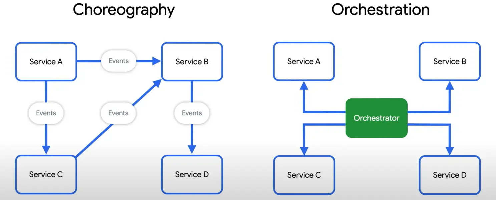

# 🔗 Sagas I — Distributed Transactions With Saga Patterns

## 🏦 Centralized vs Distributed Transactions

Monolithic applications have the advantage of being able to create transactional processes easily. Transactions help us maintain data consistency in write operations.

Since we can start a set of operations and, if successful, persist the changes. If any error occurs, we will perform a rollback, which will restore the database to a consistent state before the write operation was attempted.

While relational databases allow us to do this easily, in microservices architectures transactional processes are complex, since there is no way to centralize write operations.

To achieve transactions in microservices or distributed systems, we can learn from SAGA patterns. These will help us deal with complex distributed systems involving transactions.

## ❓ What Are SAGAS

The SAGA pattern (also known as SAGA transaction pattern) is a design pattern used in microservices architectures to handle distributed transactions. Its goal is to maintain data consistency in distributed systems where multiple services are involved in a transaction.

Instead of using a monolithic transaction involving all services that could cause locks and bottlenecks, the SAGA pattern divides the transaction into smaller steps or sequences of actions. Each step is executed as an independent transaction in the context of a specific service. These steps are organized in a logical sequence and executed sequentially or in parallel.

The SAGA pattern uses two main strategies to maintain consistency:

- **Orchestrated SAGA:** A central component (orchestrator) coordinates and directs the execution of the transaction steps. This orchestrator sends commands to the involved services to perform the necessary operations. If a step fails, the orchestrator can trigger compensation actions to reverse the changes made in previous steps.

- **Choreography SAGA:** In this approach, there is no central orchestrator. Instead, each service knows what actions it must perform and how to respond to events. Each service initiates its own transactions and sends events to trigger actions in other services. This approach can be more complex to design and maintain but can be more scalable and distributed.

## 🎨 Designing a Saga

Orchestrated or choreographed, regardless of which one, we must define the following:

- Transactions or steps
- Service operations that perform the transaction
- Communication between services

When we create a saga-based process, we will define the steps. These will be the invocations to the operations of the involved applications.

### 🛒 Saga-Based Purchase Process

We will design a purchase process for a user based on acquiring merchandise from the bands in our Spotify clone. So these are the steps:

- **create-order:** responsible for creating a new order in the system.
- **create-payment:** responsible for processing a new payment in the system.
- **update-stock:** responsible for updating the product inventory in the system.
- **create-delivery:** responsible for creating a new delivery in the system.
- **notify-purchase:** notification to the user of their purchase

Each defined step refers to an operation in a microservice. Each operation can be synchronous or asynchronous, but normally in a choreography saga it should be asynchronous using some distributed messaging strategy like RabbitMQ or Kafka.


### ⚙️ Saga Operations

Each step of our saga must define the following components:

- **Transaction:** the operation performed by the microservice. It must return a successful response or an error.
- **Compensation:** the operation that will act as a rollback, it must leave the data state in the condition prior to the performed transaction.
- **Transaction ok response:** indicates the transaction was successfully completed.
- **Transaction error:** indicates the transaction failed, and we need to determine which compensation operations should be performed at this point.

By defining this contract we can coordinate our process uniformly across the involved services. We must keep in mind that the start and end operations may differ in the implementation of these contracts, but all processes outside the start and end operations must comply with this contract.

To implement this easily, we can use a TypeScript enum.

```typescript
// libs/distributed-transactions/src/user-purchases/orchestation-saga/sagas/CreateNotificationSaga.ts
export enum CreateNotificationSaga {
    TRANSACTION = 'send-notification-transaction',
    COMPENSATION = 'notification-compensation',
    OK = 'notification-sent-ok',
    ERROR = 'notification-error'
}
// libs/distributed-transactions/src/user-purchases/orchestation-saga/sagas/CreateOrderSaga.ts
export enum CreateOrderSaga {
    TRANSACTION = 'create-order-transaction',
    COMPENSATION = 'create-order-compensation',
    OK = 'create-order-ok',
    ERROR = 'create-order-error'
}
// libs/distributed-transactions/src/user-purchases/orchestation-saga/sagas/CreatePaymentSaga.ts
export enum CreatePaymentSaga {
    TRANSACTION = 'create-payment-transaction',
    COMPENSATION = 'create-payment-compensation',
    OK = 'create-payment-ok',
    ERROR = 'payment-error'
}
// libs/distributed-transactions/src/user-purchases/orchestation-saga/sagas/DeliverySaga.ts
export enum DeliverySaga {
    TRANSACTION = 'delivery-transaction',
    COMPENSATION = 'delivery-compensation',
    OK = 'delivery-ok',
    ERROR = 'delivery-error'
}
// libs/distributed-transactions/src/user-purchases/orchestation-saga/sagas/UpdateStockSaga.ts
export enum UpdateStockSaga {
    TRANSACTION = 'update-stock-transaction',
    COMPENSATION = 'update-stock-compensation',
    OK = 'update-stock-ok',
    ERROR = 'update-stock-error'
}
```

Where each value will correspond to an endpoint or the name of a queue or messaging pattern. This way we centralize our constants and avoid typo problems. When designing complex systems, we must consider good practices from the beginning to avoid trivial errors.

### 📡 Communication Between Services

We must define how to communicate the services. Depending on the approach, we can use synchronous communication (request-response model) or asynchronous communication (event-based).

In a choreography communication, the best option is to choose message or event communication. Meanwhile, in orchestration communication, we can use both synchronous and asynchronous communication, meaning we can communicate with microservices through a REST API for synchronous communication, and through a message queue for asynchronous communication.


### 📨 Designing Event-Based Communication

Each step has already defined its operations; it is time to design the communication. Each step can communicate with others through messages, events, or request-response. In this example saga, we will design event-based communication and use the following abstract class as the base.

```typescript
// libs/distributed-transactions/src/sagas/saga.event.ts
import { IsDate, IsNotEmpty, IsString, IsUUID, ValidateNested } from 'class-validator';

type Props<T> = {
    transactionId: string;
    pattern: string;
    payload: T;
}

export abstract class SagaEvent<T> {

    @IsUUID()
    @IsNotEmpty()
    public readonly transactionId: string;

    @IsDate()
    @IsNotEmpty()
    public readonly timestamp: Date;

    @ValidateNested()
    public readonly payload: T;

    @IsString()
    @IsNotEmpty()
    public readonly pattern: string;

    constructor({ transactionId, pattern, payload }: Props<T>) {
        this.transactionId = transactionId;
        this.timestamp = new Date();
        this.pattern = pattern;
        this.payload = payload;
    }

}
```

This class will be the base for our events where we highlight the following properties:

- **transactionID:** This property relates all events to a purchase process initiated by some user. This identification is important since the services involved in 100% of the design contemplate the creation of internal IDs for their entities. So, based on this situation, each operation must be associated with a `transactionId` and we must associate all responses and requests to this identifier.

- **pattern:** This property indicates the associated operation. In an event-based architecture, this represents the message queue where the event is sent.

- **Payload:** Indicates the message content; it is the info the service needs to perform its operation.
- **timestamp:** Indicates the event creation time.
 
With our base event explained, we define the operation events:

Example of create-order-saga:
```typescript
// libs/distributed-transactions/src/user-purchases/orchestation-saga/events/create-order-transaction.event.ts
type Payload = Omit<Order, 'id'>;
export class CreateOrderTransactionEvent extends SagaEvent<Payload>{
    
    constructor(props: EventProps<Payload>) {
        super({
            ...props,
            pattern: CreateOrderSaga.TRANSACTION
        })
    }

}
// libs/distributed-transactions/src/user-purchases/orchestation-saga/events/create-order-compensation.event.ts
class Payload {
    
    @IsUUID()
    @IsNotEmpty()
    orderId: string;

}

export class CreateOrderCompensationEvent extends SagaEvent<Payload>{
    
    constructor(props: { transactionId: string, payload: Payload }) {
        super({
            ...props,
            pattern: CreateOrderSaga.COMPENSATION,
        })
    }

}
// libs/distributed-transactions/src/user-purchases/orchestation-saga/events/create-order-ok.event.ts
class Payload {
    
    @ValidateNested()
    order: Order;
    
}

export class CreateOrderOkEvent extends SagaEvent<Payload>{
    
    constructor(props: EventProps<Payload>) {
        super({
            ...props,
            pattern: CreateOrderSaga.OK
        })
    }

}
// libs/distributed-transactions/src/user-purchases/orchestation-saga/events/create-order-error.event.ts
class Payload {
    
    @IsNotEmpty()
    error: string;
    
    @IsNotEmpty()
    reason: string;

}

export class CreateOrderErrorEvent extends SagaEvent<Payload>{
    
        constructor(props: EventProps<Payload>) {
            super({
                ...props,
                pattern: CreateOrderSaga.ERROR
            })
        }
}

```

The remaining events will follow the same pattern. Depending on the operation, the event payload will vary.

### 📤 Sending Events Between Microservices

NestJS allows us to use a variety of microservice providers, depending on the case. So we create a service called `SagaExecutorService`, which will dispatch the events.

```typescript
// libs/distributed-transactions/src/sagas/services/saga-executor.service.ts
@Injectable()
export class SagaExecutorService {

    private readonly logger = new Logger(SagaExecutorService.name)

    constructor(@Inject(USER_PURCHASES_CLIENT) private client: ClientProxy) { }

    execute<T = any>(event: SagaEvent<T>) {
        this.logger.debug(`Sending Event(pattern=${event.pattern}, transaction=${event.transactionId})`)
        this.client.emit(event.pattern, event)
    }

}
```

And we can use it as follows:

```typescript
// sending events
this.sagaExecutor.execute(new DeliveryTransactionEvent({
    transactionId: event.transactionId,
    payload: {
        order: purchase.order
    }
}))
```

Regardless of the choreography or orchestration strategy, each involved microservice must comply with the following contract:

```typescript
// libs/distributed-transactions/src/sagas/ports/saga.controller.port.ts
import { RedisContext } from "@nestjs/microservices";

export abstract class SagaControllerPort<T, C> {
    abstract onTransaction(event: T, context: RedisContext): void;
    abstract onCompesation(event: C, context: RedisContext): void;
}
```

Where our microservice must define the transaction operation and the compensation operation, where the service will create the rollback of the process.

```typescript
// apps/merch-products-ms/src/delivery/infrastructure/sagas/create-delivery-saga.controller.ts
@Controller()
export class CreateDeliverySagaController extends SagaControllerPort<DeliveryTransactionEvent, DeliveryCompensationEvent> {

    private readonly logger = new Logger(CreateDeliverySagaController.name)

    constructor(
        private readonly deliveryService: DeliveryService,
        private readonly sagas: SagaExecutorService
    ) {
        super();
    }

    @EventPattern(DeliverySaga.TRANSACTION)
    async onTransaction(event: DeliveryTransactionEvent, context: RedisContext) {
        this.logger.debug(`Received Event(pattern=${event.pattern}, transactionId=${event.transactionId})`)
        this.logger.debug('Event-payload', event.payload)
        // transaction operation
    }

    @EventPattern(DeliverySaga.COMPENSATION)
    onCompesation(event: DeliveryCompensationEvent, context: RedisContext) {
        this.logger.debug(`Received Event(pattern=${event.pattern}, transactionId=${event.transactionId})`)
        this.logger.debug('Event-payload', event.payload)
        // compensation operation
    }

}

```
Our controller will automatically be associated with our messaging service defined in the microservice's `main.ts`.

> If you want to learn more about microservices in NestJS [here](https://nullpointer-excelsior.github.io/posts/arquitecturas-eda-eventos-de-dominio-vs-eventos-de-integracion/)


Depending on the chosen strategy, orchestration or choreography, the flow logic will be delegated to a central component or the involved services. In the following image we see the difference between choreography and orchestration.



- **Choreography:** Each service knows what its task is and which part of the flow it belongs to. It performs the transactions and, in case of error, invokes the compensations in the corresponding services, i.e., those that have already had correct operations.

- **Orchestration:** We will have a central component responsible for performing the operations and coordinating compensations depending on which step failed.

In the case of Choreography, the best form of communication will be through events to create a scalable and decoupled distributed system. Meanwhile, in an Orchestrated Saga, we can use both event communication and synchronous communication. It will depend on the operation and its cost. We must consider that this central component must be aware of the coherence of operations. This approach will have the advantage of being more maintainable than a choreography saga.


## 🏁 Conclusion

The SAGA pattern is essential for preserving transaction atomicity in the distributed environment of microservices. However, its implementation requires meticulous failure management, message durability, and eventual consistency to ensure data integrity. Depending on whether we use a choreography or orchestration strategy, these will depend on the case. While there are situations we do not cover in this article, the foundations are laid out and will help you understand the challenges of distributed systems.

## 🧪 Testing Sagas

To run the saga processes, start the following services:

```bash
#!/bin/bash

# start docker-compose infra 
npm run start:infra

# start saga orchestrator: user-purchases-ms
npm run start:user-purchases

# start merch-orders-ms
npm run start:merch-orders

# start merch-products-ms
npm run start:merch-products

# start merch-payment-ms
npm run start:merch-payment

```

Now run any of these scripts which simulate the possible flows

```bash
#!/bin/bash

# payment successful
./scripts/sagas-successful-purchase.sh

# payment error
./scripts/sagas-payment-error-purchase.sh

# inventory update error
./scripts/sagas-stock-error-purchase.sh

# delivery error
./scripts/sagas-delivery-error-purchase.sh

```
