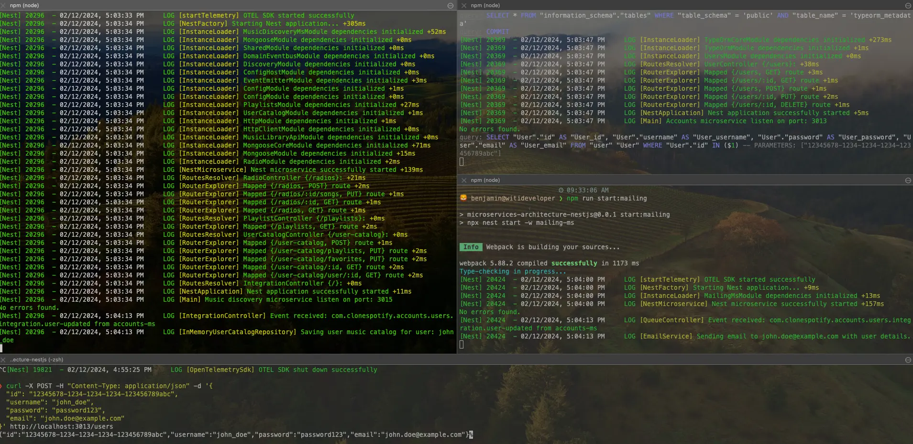

# 📨 EDA Architectures: Domain Events vs Integration Events

Asynchronous communication between microservices helps us create complex processes where system responsibilities are distributed across different applications. As per the microservices philosophy, separating responsibilities to keep certain characteristics independent from each other helps us achieve scalability, load handling, and fault tolerance, but this comes with a great communication challenge. Communicating a service synchronously and waiting for a response is not always viable. There are workloads that do not require an immediate response, and often this can fail and break the entire flow of an important process. Nobody wants this in a purchase of considerable value.

When synchronous communication is not the option, I present EDA architectures, or event-driven architectures. This approach gives us the possibility to communicate with both internal components of an application and with external services or applications. This time we will analyze domain events and integration events.

## 📡 Event-Based Communication

Integrating applications and services using event-driven architectures is essential for creating robust and flexible systems. Two fundamental concepts in this area are domain events and integration events. Both play crucial roles but are applied in somewhat different contexts, yet they are compatible with each other, allowing us to create complex and decoupled systems.

### 🏛️ Domain Events:

Domain events are fundamental in domain-driven design or DDD, a technique focused on modeling the system according to the business domain it belongs to. These events represent significant changes in the domain state and are usually closely linked to domain model concepts. They also represent past domain facts, for example: `user-created`, `user-banned`, `stock-updated`, etc.

> While you find domain events a lot in systems built with DDD, nobody prevents you from using them in simpler architectures like N-tier.

#### 🔑 Key Characteristics:

- **Business Context**: Domain events originate in the business core and reflect actions or changes relevant to the domain.
- **Decoupling**: They allow efficient decoupling between different parts of the system by focusing on domain semantics rather than implementation details.
- **Precise Modeling**: By reflecting domain-specific events, these events contribute to more precise and representative business modeling.

### 🔗 Integration Events:

Integration events are messages designed to coordinate interaction between microservices or applications. These events address the need for synchronization and collaboration in a distributed environment. These events represent messages exchanged between components or services to maintain coherence and synchronization in the software ecosystem.

#### 🔑 Key Characteristics:

- **Inter-Service Communication**: Integration events facilitate communication between different services or components, enabling collaboration in a distributed environment.
- **System Decoupling**: By using events for integration, effective decoupling between systems is achieved, facilitating scalability and independent evolution of each component.
- **Interoperability**: They are essential for achieving interoperability between heterogeneous systems, as they provide a standardized means of information exchange.

It is crucial to understand that domain events and integration events serve different purposes but are not mutually exclusive. In fact, their combined use can enhance the effectiveness of a system.

## 🎯 Domain Events Use Cases:

In our **Spotify-clone** architecture, we will see domain events occurring in the `music-discovery-ms` microservice. This application contains the following modules:

- **user-catalog**: user's music catalog with personal playlists, favorite artists, and songs.
- **playlist-catalog**: catalog of playlists offered to users.
- **shared**: shared components between modules.

### 📝 Use Case: The public playlist catalog must be updated when the user updates their public-type playlists.

When a user creates a playlist in their catalog, if it is of public type, it must be automatically added to the **Spotify-clone** playlist catalog to be efficiently indexed.

Analyzing the use case, all we would have to do is invoke the repository responsible for the **Spotify-clone** playlist when the user updates their playlist. But for real examples, assuming the code complexity is high, coupling the `user-catalog` module with `playlist-catalog` in the use case of updating the user catalog has nothing to do with the use case of updating the playlist catalog. This does not even allow our code to be scalable. To solve this, we will communicate these 2 modules through domain events.

First, we create within the `libs/utils` library of the monorepo project a DDD utility library called `seedwork` with a base class for domain events.

> `seedwork` The name refers to a type of mini framework of own utilities, but applied at the local level of your project. You can find it with other names like shared-kernel, commons, core, etc.

```typescript
//libs/utils/src/seedwork/domain/events/eventbus.ts
export abstract class DomainEventBus {
    abstract publish<T extends DomainEvent<any>>(event: T): void
}
//libs/utils/src/seedwork/domain/events/domain.event.ts
export abstract class DomainEvent<T = any> {

    public readonly id: string;
    public readonly occurredOn: Date;
    
    constructor(
        public readonly name: string,
        public readonly payload: T
    ) {
        this.id = uuid.generate();
        this.occurredOn = new Date();
    }

}
```

We use the NestJS [eventemitter](https://docs.nestjs.com/techniques/events) library to create an in-memory eventbus to emit events.

```typescript
// libs/utils/src/seedwork/infrastructure/domain-eventbus/services/event-emitter.eventbus.ts
@Injectable()
export class EventEmitterEventbus implements DomainEventBus {

    constructor(private eventEmitter: EventEmitter2) {}
   
    async publish<T extends DomainEvent<any>>(event: T) {
        this.eventEmitter.emit(event.name, event);
    }

}
```

We generate domain events within the `shared` module of `music-discovery`.

```typescript
// apps/music-discovery-ms/src/shared/domain-events/user-music-catalog/playlist-updated.event.ts
export class PlaylistUpdatedEvent extends DomainEvent<Playlist> { 
    
    constructor(playlist: Playlist) {
        super(PlaylistUpdatedEvent.NAME, playlist);
    }

    static readonly NAME = 'com.clonespotify.discovery.user-music-catalog.domain.playlist-updated';
    
}
```

> We use the pattern spotifyclone.*FEATURE*.domain.*EVENT* to be able to perform filtering patterns on events in more complex cases.

Now our use case would be the following.

```typescript
// apps/music-discovery-ms/src/user-catalog/application/dto/update-playlists.dto.ts
export class UpdatePlaylistsDto {
    
    @IsUUID()
    @IsNotEmpty()
    userCatalogId: string;

    @ValidateNested({ each: true })
    playlist: Playlist;
    
}
// apps/music-discovery-ms/src/user-catalog/domain/model/playlist.model.ts
export class Playlist extends Model {
    
    @IsNotEmpty()
    name: string;
    
    @IsBoolean()
    isPublic: boolean;
    
    @IsArray()
    @ValidateNested({ each: true })
    @Type(() => Song)
    songs: Song[];

}
// apps/music-discovery-ms/src/user-catalog/application/user-catalog.use-cases.ts
@Injectable()
export class UserCatalogUseCases {

    constructor(
        private readonly catalog: UserCatalogService,
        private readonly domainEventbus: DomainEventBus
    ) { }

    async updatePlaylists(dto: UpdatePlaylistsDto) {

        const playlistNotToUpdate = (playlists) => playlists.filter(p => p.id !== dto.playlist.id);

        return await this.catalog.findById(dto.userCatalogId)
            .then(catalog => {
                catalog.playlists = [
                    ...playlistNotToUpdate(catalog.playlists),
                    dto.playlist
                ]
                return catalog
            })
            .then(async catalog => {
                await this.catalog.save(catalog)
                return catalog
            })
            .then(catalog => {
                this.domainEventbus.publish(new PlaylistUpdatedEvent(dto.playlist));
                return catalog
            });

    }

}
```

Our use case is simple, we just receive a DTO with the playlist information to update and send the domain event with `domainEventBus.publish()`.

Thanks to NestJS, we can listen for this event using annotations in any `@Injectable` service.

```typescript
// apps/music-discovery-ms/src/playlist-catalog/infrastructure/domain-events/domain-event.listener.ts
@Injectable()
export class DomainEventListener {

    constructor(private readonly playlist: PlaylistUseCases) {}

    @OnEvent('com.clonespotify.discovery.user-music-catalog.domain.playlist-updated')
    async onPlaylistCreated(event: PlaylistUpdatedEvent) {
        const playlist = event.payload
        if (playlist.isPublic) {
            await this.playlist.create(playlist)
        }
    }

}
```

Finally, we receive the playlist through an event and if it is public, it will be saved in the database in the `playlist-catalog` module. This way, we have decoupled 2 totally different use cases where the playlist model has a different meaning depending on the domain context it is in.

## 🎯 Integration Events Use Cases:

We already understand that integration events help us communicate different applications. To exemplify this concept, we will take the user creation use case within the `accounts-ms` microservice, which is dependent on a larger use case called "User Welcome".

### 📝 Use Case: User Welcome

This use case involves 3 applications:
- `account-ms`: responsible for account and user management.
- `mailing-ms`: responsible for sending email notifications.
- `music-discovery-ms`: responsible for managing music that interests or may interest the clonespotify user.

Our use case is simple. When a user is created within `accounts-ms`, we need to send a welcome email to the user and also need to initialize the user's initial catalog.

This simple use case involves different services, and as we can see at first glance, each of them has totally different responsibilities from each other, but thanks to integration events we can achieve a distributed process between our services with low coupling.

The first thing will be to define the event architecture. To achieve this, we will use the `pub/sub` model, which will allow multiple clients to subscribe to an event and perform their operations.

Let's create a Redis service in our docker-compose.

```yml
# infrastructure/local/docker-compose.yaml
version: '3'
services:
  # ... other services
  redis:
    container_name: redis
    image: redis:6.2-alpine
    restart: always
    ports:
      - ${REDIS_PORT}:6379
    command: redis-server --save 20 1 --loglevel warning --requirepass ${REDIS_PASS}
    networks:
      - microservices-architecture
```

We install the following dependency.

```bash
npm i --save ioredis 
```

NestJS offers this `pub/sub` model based on a Redis server, which will help us apply and listen to events in a fire-and-forget manner, which has the disadvantage that if nobody listens to the emitted messages, they will be lost. But for learning purposes, this will be enough.

The `pub/sub` implementation is simple, so we define the following shared library in our monorepo.

```bash
 integration-events
├──  src
│   ├──  config
│   │   └──  constants.ts
│   ├──  events
│   │   ├──  accounts-ms
│   │   │   └──  user-created.event.ts
│   │   ├──  integration.event.ts
│   │   ├──  integration.eventbus.ts
│   │   └──  music-discovery-ms
│   │       └──  user-favorites-updated.event.ts
│   ├──  index.ts
│   ├──  integration-events.module.ts
│   ├──  services
│   │   └──  redis.eventbus.ts
│   └──  transporters
│       ├──  get-microservice-options.ts
│       └──  redis
│           └──  get-redis-options.ts
└──  tsconfig.lib.json
```

We define our EventBus.

```typescript
// libs/integration-events/src/events/integration.eventbus.ts
export abstract class IntegrationEventBus {

    abstract publish<T>(event: IntegrationEvent<T>): IntegrationEvent<T>;

}
// libs/integration-events/src/services/redis.eventbus.ts
@Injectable()
export class RedisEventBus extends IntegrationEventBus {

    constructor(@Inject(REDIS_PRODUCER_CLIENT) private client: ClientProxy) {
        super()
    }

    publish<T>(event: IntegrationEvent<T>): IntegrationEvent<T> {
        this.client.emit(event.name, event)
        return event
    }

}
// libs/integration-events/src/integration-events.module.ts
const IntegrationEventbusProvider = {
  provide: IntegrationEventBus,
  useExisting: RedisEventBus
}

@Module({
  providers: [
    RedisEventBus,
    IntegrationEventbusProvider
  ],
  exports: [
    IntegrationEventbusProvider
  ],
  imports: [
    ClientsModule.registerAsync([
      {
        name: REDIS_PRODUCER_CLIENT,
        imports: [
          ConfigModule.forRoot()
        ],
        useFactory: (config: ConfigService) => {
          const host = config.get('REDIS_HOST')
          const port = config.get('REDIS_PORT')
          const password = config.get('REDIS_PASS') 
          return {
            transport: Transport.REDIS,
            options: {
              host,
              port,
              password
            }
          }
        },
        inject: [
          ConfigService
        ]
      },
    ]),
  ]

})
export class IntegrationEventsModule { }
```

We define the events.

```typescript
// libs/integration-events/src/events/integration.event.ts
export abstract class IntegrationEvent<T> {

    public readonly id: string;
    public readonly occurredOn: Date;
    
    constructor(
        public readonly service: string,
        public readonly name: string,
        public readonly payload: T
    ) {
        this.id = uuid.generate();
        this.occurredOn = new Date();
    }

}
// libs/integration-events/src/events/accounts-ms/user-created.event.ts
export interface Payload {
    id: string;
    username: string;
    email: string;
}

export class UserCreatedEvent extends IntegrationEvent<Payload> {
    constructor(payload: Payload) {
        super('accounts-ms', 'com.clonespotify.accounts.users.integration.user-updated', payload);
    }
}
```

### 📤 Sending Integration Events

Now, within the `users` module of `accounts-ms`, we import our library to instantiate the eventbus.

```typescript
// apps/accounts-ms/src/users/users.module.ts
@Module({
    // ...more code
    imports:[
        IntegrationEventsModule
    ]
})
export class UsersModule {}
```

And we use `IntegrationEventBus` within our UserService.

```typescript
// apps/accounts-ms/src/users/service/user.service.ts
@Injectable()
export class UserService {
  
  constructor(
    @InjectRepository(User) private repository: Repository<User>,
    private readonly integrationEventBus: IntegrationEventBus
  ) {}

  async create(user: UserModel): Promise<User> {
    const userCreated = await this.repository.save(user);
    this.integrationEventBus.publish(new UserCreatedEvent({
      id: userCreated.id,
      username: userCreated.username,
      email: userCreated.email
    }));
    return userCreated;
  }

}
```

With this, events will be sent to the Redis server and those listening will receive the messages.

### 📥 Listening to Integration Events

Now, to listen to events, we instantiate our NestJS microservice in the applications that need the integration events.

```typescript
// libs/integration-events/src/transporters/get-microservice-options.ts
export function getMicroserviceOptions() {
    return {
        transport: Transport.REDIS,
        options: {
            host: process.env.REDIS_HOST || 'localhost',
            port: process.env.REDIS_PORT || 6379,
            password: process.env.REDIS_PASS || undefined
        }
    }
}
```

Microservice: `mailing-ms`

```typescript
// apps/mailing-ms/src/main.ts
async function bootstrap() {
  const app = await NestFactory.createMicroservice(MailingMsModule, getMicroserviceOptions());
  await app.listen();
}
```

Microservice: `music-discovery-ms`

```typescript
// apps/music-discovery-ms/src/main.ts
async function bootstrap() {
  
  const app = await NestFactory.create(MusicDiscoveryMsModule);
  app.useGlobalPipes(new ValidationPipe())
  app.connectMicroservice(getMicroserviceOptions())
// other features...
  await app.listen(port, () => {
    Logger.log(`Music discovery microservice listen on port: ${port}`, "Main")
  });
  
}
```

Finally, we define the controllers with their message pattern and execute the business logic we want.

Sending welcome email when a user is created in the `mailing-ms` microservice.

```typescript
// apps/mailing-ms/src/integration-events/controllers/integration.controller.ts
@Controller()
export class IntegrationController {
  
  constructor(private readonly email: EmailService) {}

  @MessagePattern('com.clonespotify.accounts.users.integration.user-updated')
  onUserCreated(@Payload() data: UserCreatedEvent, @Ctx() context: RmqContext) {
    Logger.log(`Event received: ${data.name} from ${data.service}`, 'QueueController')
    this.email.notifyUserDetails(data);
  }

}
```

Creating the initial user catalog when a new user is created in the `music-discovery-ms` microservice.

```typescript
// apps/music-discovery-ms/src/user-catalog/infrastructure/integration-events/integration.controller.ts
@Controller()
export class IntegrationController {

    constructor(private readonly catalog: UserCatalogUseCases) {}

    @MessagePattern('com.clonespotify.accounts.users.integration.user-updated')
    onUserCreated(@Payload() event: UserCreatedEvent, @Ctx() context: RedisContext) {
        Logger.log(`Event received: ${event.name} from ${event.service}`, 'IntegrationController')
        this.catalog.createMusicCatalog({
            id: Model.generateUUID(),
            user: {
                id: event.payload.id,
                username: event.payload.username
            }
        })
    }
}
```

Finally, to see the example working, execute the following.

```bash
npm run start:infra
npm run start:accounts
npm run start:mailing
npm run start:music-discovery
```

And send a curl to `accounts-ms`.

```bash
curl -X POST -H "Content-Type: application/json" -d '{
  "id": "12345678-1234-1234-1234-123456789abc",
  "username": "john_doe",
  "password": "password123",
  "email": "john.doe@example.com"
}' http://localhost:3013/users
```

Finally, you will see the application logs.



## 🏁 Conclusion

We explored domain and integration events with a practical and easy-to-understand approach. Integration events help us create fully decoupled systems, and domain events help us better model business logic, creating fully decoupled code with the ability to be maintainable over time.
